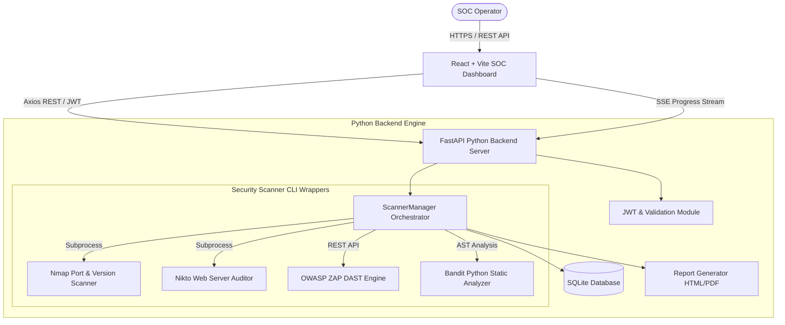
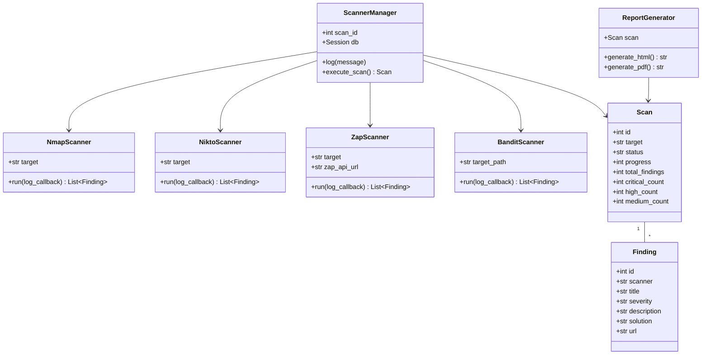

# Automated Security Scanner & SOC Dashboard

> **Enterprise-Grade Cybersecurity Vulnerability Scanner & SOC Operations Dashboard**

A full-stack, automated security assessment and vulnerability management system featuring a **FastAPI Python Backend** with multi-tool scanning orchestration (Nmap, Nikto, OWASP ZAP, Bandit), SQLite storage, HTML/PDF executive reporting, real-time SSE progress streaming, and a **modern React.js + Vite + Tailwind CSS SOC Dashboard**.

---

## 🛡 System Architecture



---

## 📐 UML Class Architecture



---

## ⚡ Quick Start & Setup Guide (Windows / Cross-Platform)

### 1. Prerequisites
- **Python 3.11+** installed and added to system `PATH`
- **Node.js v18+ / v20+** installed
- Optional Security CLI Tools (Supported via native detection or fallback audit simulation mode):
  - **Nmap**: Download Windows installer from [nmap.org](https://nmap.org/download.html)
  - **Nikto**: Install via Perl or Git clone
  - **Bandit**: Installed via `pip install bandit`
  - **OWASP ZAP**: Download ZAP Desktop/Daemon from [zaproxy.org](https://www.zaproxy.org/download/)

---

### 2. Backend Setup & Run

1. Open a terminal in the `backend` directory:
   ```bash
   cd backend
   ```

2. Install Python dependencies:
   ```bash
   pip install -r requirements.txt
   ```

3. Run unit tests to verify system integrity:
   ```bash
   python -m pytest tests/
   ```

4. Launch the FastAPI server:
   ```bash
   python app.py
   # Or using uvicorn directly:
   uvicorn app:app --reload --host 127.0.0.1 --port 8000
   ```
   *FastAPI server will listen on `http://127.0.0.1:8000` (OpenAPI Docs at `http://127.0.0.1:8000/api/docs`).*

---

### 3. Frontend Setup & Run

1. Open a new terminal in the `frontend` directory:
   ```bash
   cd frontend
   ```

2. Install Node dependencies:
   ```bash
   npm install
   ```

3. Start the Vite development server:
   ```bash
   npm run dev
   ```
   *The SOC Dashboard will open on `http://localhost:5173`.*

---

## 🚀 Key Features & UX Walkthrough

1. **SOC Executive Dashboard**:
   - Animated statistics counter cards (Total Scans, Vulnerabilities, Critical Issues, Open Ports).
   - Recharts Donut severity breakdown chart (Critical, High, Medium, Low) with interactive selection filtering.
   - Recharts Bar activity frequency chart with 7-Day, 30-Day, and 90-Day timeframe toggling.
   - Recent Scans table preview with direct results linking.

2. **New Scan Launchpad**:
   - Target domain / IP / local directory input with validation.
   - Selectable cards with checkmarks for Nmap, Nikto, OWASP ZAP, and Bandit.
   - **Authorization Verification Dialog**: Mandatory confirmation modal requiring explicit target testing consent before scan initiation.

3. **Real-Time Scanning Interface**:
   - Animated overall progress bar with step-by-step checklist status.
   - Live streaming terminal log console capturing stdout/stderr output without page refresh (using Server-Sent Events).

4. **Results & Vulnerability Drawer**:
   - Executive vulnerability count summary cards.
   - Filterable, searchable, and paginated data table of findings.
   - Slide-over detail drawer displaying evidence, recommendations, and status toggling ("Mark as Resolved").

5. **Reports & Exporting**:
   - One-click HTML Executive Summary preview.
   - Native cross-platform PDF report generation compiled via `ReportLab`.

---

## 🎓 College Project Presentation Points

When presenting this project for technical evaluation or academic demo:

1. **Modularity**: Scanners are implemented as decoupled modules in `scanner/`, adhering to object-oriented single-responsibility principles.
2. **Command Injection Prevention**: CLI tools are executed using `subprocess` with explicit list arguments (e.g. `['nmap', '-sV', target]`), eliminating `shell=True` vulnerabilities.
3. **Graceful Fallback**: If security CLI tools are missing on a host machine, the backend detects tool absence and activates diagnostic simulation mode so UI demos remain fully functional.
4. **Real-Time Streaming**: Uses Server-Sent Events (SSE) for low-overhead, one-way log streaming to the React UI.

---

## 🔮 Future Enhancements
- Docker containerization (`docker-compose` for API + ZAP daemon + Frontend).
- Integration with CVE vulnerability lookup APIs (NVD / VulnDB).
- Automated CI/CD security pipeline webhook triggers (GitHub Actions / GitLab CI).
